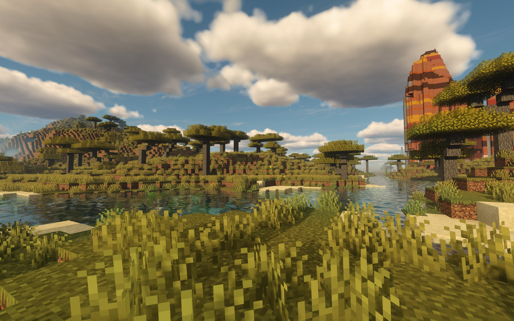
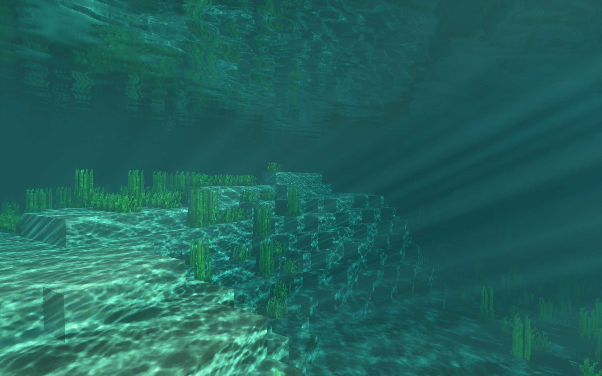
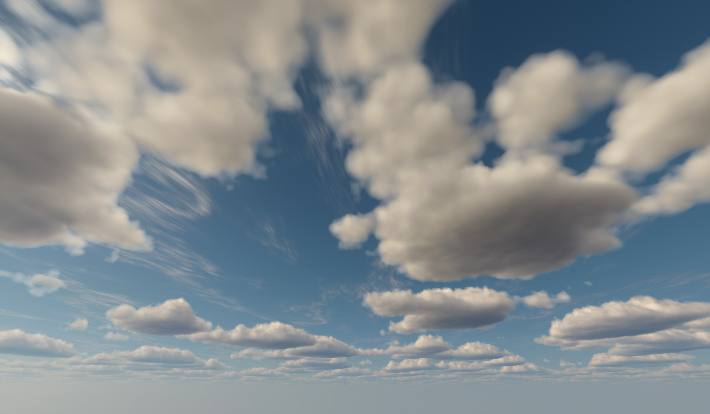

# Vibroscat

[English](README.md) | [简体中文](README.zh-CN.md)

Vibroscat is a shaderpack for Iris. It renders natural daylight, layered
volumetric clouds, clear water, and soft shadows with a restrained filmic
finish, while keeping Minecraft's block-shaped look.

## Development status

Vibroscat is in early development; the current release is Alpha V0.4.0. Many
effects are unfinished, settings are incomplete, and versions may break
compatibility with each other.

## Screenshots

All screenshots were captured in game at 2560 pixels wide with the default
Vibroscat profile.

## Effects

- Layered volumetric clouds with wind, sunlight, and optional cloud shadows
  that track the moving cloud cover
- Day/night sky with sunsets, moonlight, stars, and a Milky Way that shows
  through clouds and in reflections, plus horizon haze
- Exponential height fog with light shafts; density varies with day, twilight,
  night, and rain
- Clear water with waves, reflections, refraction, caustics, underwater fog,
  and underwater sun shafts
- Rain that wets exposed ground, with optional puddles and ripples, then dries
- Soft sun shadows with contact detail, ambient occlusion, and light passing
  through foliage
- Wind-swayed grass and foliage with matching shadows
- Selectable global illumination: none, screen-space (SSGI), or reflective
  shadow map (RSM) GI
- Reflections on solid surfaces; LabPBR (default) and oldPBR material maps
- TAA antialiasing, plus optional temporal upscaling (TAAU) at a 50-85% render
  scale
- Automatic exposure, bloom, depth of field, motion blur, sharpening, and
  selectable tone mapping

Vibroscat shades the Overworld only; the Nether and the End currently render
with vanilla visuals.

## Requirements

- Minecraft Java Edition 26.2 with Fabric Loader 0.19.x, and matching Iris and
  Sodium builds
- Java 21
- A GPU with an up-to-date driver supporting OpenGL 4.3 or newer (the pack
  uses compute shaders and SSBOs)

## Performance

Vibroscat is developed and tested on an NVIDIA GeForce RTX 5070 Ti Laptop GPU
(Windows). Four quality profiles (Low, Medium, High, Ultra) are built into
the settings, and the defaults equal Medium. If the frame rate is too low,
pick a lower profile.

## Installation

Download the release archive and place it in the `shaderpacks` directory. Keep
the archive intact, or extract it so that `shaders` is directly inside the
Vibroscat folder. Select Vibroscat from the Iris shader-pack menu, then choose
a quality profile in Shader Pack Settings.

## License

Vibroscat is released under GPL-3.0. See [LICENSE](LICENSE) and
[third-party notices](licenses/THIRD_PARTY_NOTICES.en.md).
