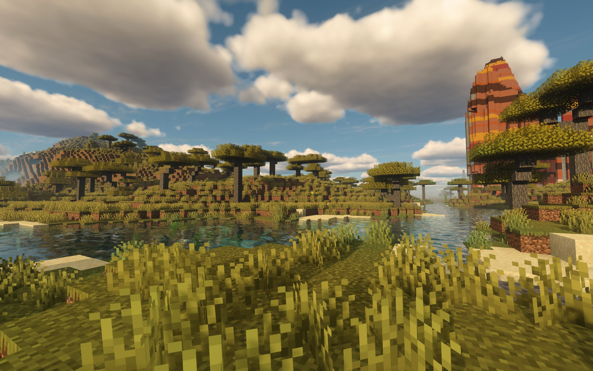
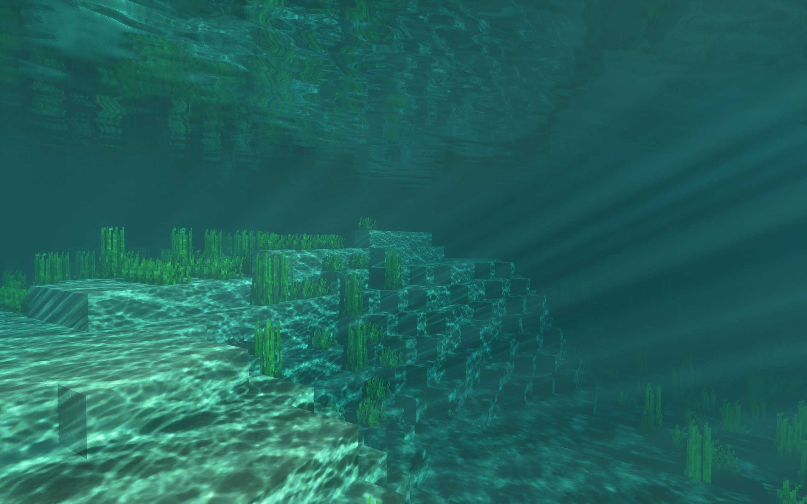
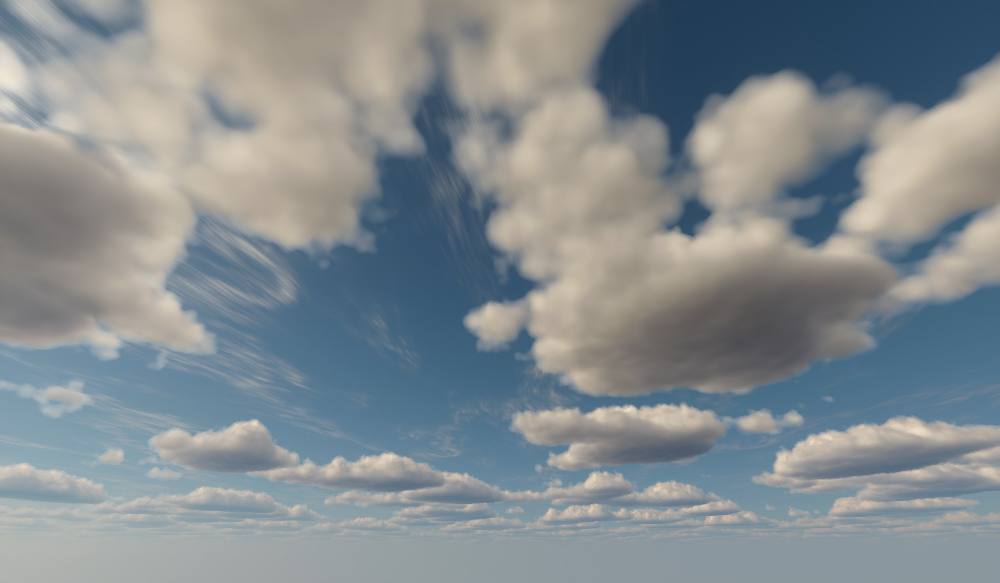

# Vibroscat

[English](README.md) | [简体中文](README.zh-CN.md)

Vibroscat 是一款面向 Iris 的 Minecraft 光影包。它呈现自然的日光、分层的体积云、清澈的水面与柔和的阴影，画面收敛克制，同时保留方块世界的本色。

## 开发状态

Vibroscat 仍处于早期开发阶段，当前版本为 Alpha V0.4.0。不少效果尚未完成，设置尚不齐全，版本之间可能出现不兼容改动。

## 截图

所有截图均在游戏内以 2560 像素宽、默认配置拍摄。

## 效果

- 分层体积云：随风移动、带阳光，可选随云层移动的云影
- 昼夜天空：日落、月光、星空，银河可透过云层并出现在反射中，另有地平线霾
- 指数高度雾与光柱；白天、黄昏、夜间与雨天的雾密度各不相同
- 清澈的水面：波浪、反射、折射、焦散、水下雾与水下光柱
- 雨天露天生效的地面湿润，可选水坑与涟漪，雨后逐渐干燥
- 柔和的太阳阴影，带接触细节、环境光遮蔽与透过树叶的光
- 随风摆动的草与树叶，阴影同步移动
- 可切换全局光照：关闭、屏幕空间（SSGI）或反射阴影贴图（RSM）
- 不透明表面反射；支持 LabPBR（默认）与 oldPBR 材质
- TAA 抗锯齿，另有可选的时域超分辨率（TAAU），渲染比例 50%–85%
- 自动曝光、泛光、景深、动态模糊、锐化与多种可选色调映射

Vibroscat 仅作用于主世界；下界与末地目前使用原版画面。

## 系统要求

- Minecraft Java 版 26.2、Fabric Loader 0.19.x，以及对应版本的 Iris 与 Sodium
- Java 21
- 显卡驱动保持最新，且支持 OpenGL 4.3 及以上（光影包使用了计算着色器与 SSBO）

## 性能

Vibroscat 在 NVIDIA GeForce RTX 5070 Ti Laptop 显卡（Windows）上开发与测试。
光影包内置四档画质（低、中、高、超），默认设置与中档一致。帧率不足时，请
选择更低的画质档位。

## 安装

下载发布压缩包，放进 `shaderpacks` 目录即可。可以不解压直接放入，也可以
解压后放入，只要保证 `shaders` 文件夹直接位于 Vibroscat 目录内。进游戏后，
在 Iris 的光影菜单里选中 Vibroscat，再到光影包设置里选择画质。

## 许可证

Vibroscat 以 GPL-3.0 协议开源。详见 [LICENSE](LICENSE) 与
[第三方声明](licenses/THIRD_PARTY_NOTICES.md)。
